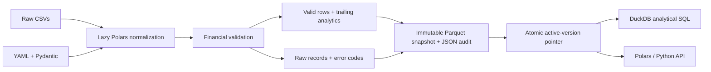

# Research Data Engine

**A local tool for preparing stock-price files for research.**

Read a price CSV, make its fields consistent, check the records, calculate basic measures, and save a reusable dataset. Polars handles preparation; DuckDB provides optional SQL access to the saved Parquet files.

This is an **independent portfolio project**. BMO did not commission this software; no BMO use or endorsement is implied. All bundled demonstrations and benchmarks use **synthetic** unadjusted prices, not real market data.

## Why it exists

Research datasets often arrive with inconsistent column names, mixed text/numeric types, duplicate security/date observations, and financial inconsistencies. Repeating ad-hoc cleaning makes research harder to audit. This tool turns those decisions into a small versioned contract: every record either passes or has a recorded reason for quarantine/rejection, and every published run records input hashes and configuration.

## Implemented capabilities

- Deterministic multi-file lazy CSV scanning; declarative column/date mappings; explicit Date/Float64/Int64 schema.
- Financial invariants, all-member duplicate quarantine, configurable whole-run rejection, raw-value/file provenance.
- Retained anomaly warnings for extreme returns, volume changes, stale closes, and optional approximate weekday gaps.
- Per-symbol/source price returns, log returns, 20/30-observation realized volatility, 20-observation average volume, approximate dollar volume.
- Zstd Parquet snapshots; safe manifest publication; repeat ingestion replaces the active dataset without appending duplicates.
- Direct Parquet SQL through DuckDB, parameterized date/symbol filtering, Polars results, and a public Python API.
- Correctness-gated pandas/Polars/DuckDB benchmarks with isolated workers, wall/CPU timing, sampled native-process RSS, and measured reports.
- Installable Typer CLI, focused pytest tests, Ruff, GitHub Actions, SQL/Python examples, and an interview walkthrough.
- Two frontend pages: a plain-language five-step walkthrough and a practical research workspace with stock/date filters, quality review, charts, and CSV export.

## Interactive walkthrough

**How it works** explains the five steps on one page, with definitions, examples, and actual row accounting. **Research workspace** shows a practical task: choose a stock and dates, inspect a cleaned price history and data-quality flags, then export the selected observations. All 50 synthetic stocks are available; histories load one at a time. Supporting tests and benchmark evidence remain available without leading the presentation.

```bash
node frontend/build.mjs
python3 -m http.server 4173 --bind 127.0.0.1 --directory frontend/dist
```

Open **http://127.0.0.1:4173** for the explanation or **http://127.0.0.1:4173/workspace.html** for the use case. The frontend has no JavaScript runtime dependencies. Its included evidence was exported from the real Python engine; it does not execute new pipeline runs or SQL in the browser. [Frontend instructions](frontend/README.md) explain refresh, verification, downloads, and hosting.

## Architecture



Polars owns normalization, validation, and financial transformations; DuckDB owns the SQL research interface. Parquet preserves types and supports column/predicate pushdown where its layout permits. pandas supplies the benchmark baseline. There is no service, cloud dependency, live-data API, or orchestration platform. See [architecture](docs/architecture.md) and [design trade-offs](docs/design_decisions.md).

## Installation and quick start

Requires **Python 3.12+** and [uv](https://docs.astral.sh/uv/getting-started/installation/). Python 3.12 is selected by `.python-version`; uv can provision it when needed. From this repository's root:

```bash
uv sync --locked
uv run research-data --help
uv run research-data demo
uv run pytest
uv run ruff check .
uv run ruff format --check .
```

The demo needs no API keys or external service after dependency installation. It generates 50 synthetic securities for 2021–2025 using a **weekday approximation**, deliberately injects defects, publishes valid data, and runs a DuckDB summary. Expected accounting: **65,201 input rows → 65,194 valid rows + 7 quarantined rows**. Extreme price/volume movements remain warning flags. Reports and quarantine paths print in the terminal.

If the environment is already installed, `.venv/bin/research-data demo` runs directly on macOS/Linux. Use `--directory /tmp/research-data-demo` to isolate demo artifacts; pass that directory's `processed/equity_prices` path to subsequent query/validate commands.

## CLI examples

```bash
# Standalone deterministic SYNTHETIC generator; omit --dirty for fully valid input.
uv run python scripts/generate_sample_data.py --dirty
uv run research-data ingest --config configs/prices.yaml
uv run research-data validate --dataset prices --report data/validation.json
uv run research-data query --sql examples/daily_returns.sql
uv run research-data query --sql examples/rolling_volatility.sql
uv run research-data query --sql examples/security_summary.sql
uv run research-data benchmark --rows 1000000 --repetitions 3

# JSON-structured pipeline events:
uv run research-data --verbose ingest --config configs/prices.yaml
```

`prices` and the configured dataset name resolve explicitly through `--config` (default `configs/prices.yaml`). Without that file, `prices`/`equity_prices` use `data/processed/equity_prices`. An existing dataset directory can be supplied directly with `--dataset`. Unknown aliases fail. `validate` checks the active stored snapshot using its recorded policies; it does not rerun raw ingestion or replace the snapshot. SQL files contain one SELECT/WITH statement against the `prices` view. `--limit` controls displayed rows, not query computation. Failures return nonzero exit codes.

YAML paths resolve relative to the YAML file. The bundled config therefore uses `../data/raw` and `../data/processed/equity_prices`. For real vendor CSVs, copy the config, change path/source/mappings/date format, and choose suitable policies/calendar. See the complete [configuration and data contract](docs/data_contract.md).

## Validation you can inspect

The observation key is `(symbol, date, source)`. Different sources never share return/rolling calculations. Duplicates quarantine **all** members; the pipeline never picks an arbitrary winner. OHLC must be positive and finite; high/low bounds must be consistent; volume must be a nonnegative Int64. Parsing failures retain original mapped text. No prices are interpolated or zero-filled.

`quarantine` publishes remaining valid records and saves errors; `reject` fails the whole run and preserves the previous active snapshot. Default missing-value behavior is rejection; the demo explicitly configures quarantine. An extreme return is a warning, never automatically an error. Overlapping error counts can exceed the number of quarantined rows. See [all validation rules](docs/validation_rules.md).

```python
import json
import polars as pl
from research_data_engine import read_snapshot

snapshot = read_snapshot("data/processed/equity_prices")
print(json.loads(snapshot.report_path.read_text())["errors_by_category"])
print(
    pl.read_parquet(snapshot.directory / "quarantine.parquet").select(
        "_source_file", "_source_row", "_errors", "_raw_record"
    )
)
```

The active version contains `prices.parquet`, `quarantine.parquet`, `report.json`, and `metadata.json`. `CURRENT.json` selects exactly one version; do not glob historical versions or quarantine into your queries. Old snapshots remain available for audit. Reports include UTC timestamps, resolved settings, input hashes, package versions, row/error/warning/null counts, duration, and output location.

## Python and SQL research

```python
from research_data_engine import QueryEngine, ingest, load_prices

# After `research-data demo`; all SYN* observations are SYNTHETIC.
prices = load_prices(
    symbols=["SYN0000", "SYN0001"],
    start="2025-01-01",
    end="2025-12-31",
)
print(prices.select("symbol", "date", "simple_return", "realized_vol_20").head())

with QueryEngine() as engine:
    summary = engine.query("""
        SELECT symbol, source, avg(simple_return) AS mean_price_return,
               stddev_samp(simple_return) AS daily_price_volatility
        FROM prices WHERE date >= DATE '2025-01-01'
        GROUP BY symbol, source ORDER BY mean_price_return DESC
    """)
    print(summary.head())

# The library also runs the same ingestion pipeline as the CLI:
# run = ingest("configs/prices.yaml")
```

`simple_return = close / prior_retained_close - 1`; `log_return = ln(close) - ln(prior_retained_close)`. Realized volatility uses **sample standard deviation**, 252-session annualization, and a full trailing 20/30 log-return window (21/31 prices). Windows include current and prior observed rows. The API filters already-computed analytics so the requested start date retains historical context. Returns spanning missing observations span the gap; they are not necessarily one-session returns. Prices are **not adjusted for splits or dividends**, so these are price returns, not total shareholder returns.

Run `uv run python examples/research_example.py` for a complete API example and the actual optimized Polars scan plan showing date-predicate and column-projection pushdown. [The data contract](docs/data_contract.md) specifies window, source, and provenance semantics.

## Measured performance

Measured on October 18, 2026, with Python 3.12.15, Polars 1.44.2, DuckDB 1.5.6, pandas 3.0.6, 8 ARM CPUs, and 8 GiB physical RAM. Three repetitions after one warmup; medians of fully materialized wall-clock operations. All five full-result comparisons passed **before timing**. These numbers describe synthetic local workloads, not a general speed guarantee.

| Workload | Candidate | 100k speedup | 1M pandas ms | 1M candidate ms | 1M speedup |
|---|---|---:|---:|---:|---:|
| Typed CSV ingestion | Polars | 14.33× | 657.353 | 44.646 | 14.72× |
| Grouped volume/return means | Polars | 3.85× | 56.641 | 11.389 | 4.97× |
| Sorted rolling volatility | Polars | 3.12× | 124.828 | 64.154 | 1.95× |
| Date filter and grouped means | Polars | 2.97× | 22.097 | 3.551 | 6.22× |
| Parquet filter/aggregate | DuckDB | 1.68× | 35.347 | 9.072 | 3.90× |

Speedup = pandas median wall time / candidate median wall time. pandas uses vectorized datetimes for in-memory filters and PyArrow projection/predicate pushdown for Parquet. CSV includes loading; B/C/D exclude preloading; E includes reading Parquet. DuckDB returns a Polars result, pandas a pandas result. OS caches are warm. Native parallelism can improve wall time while using more total CPU.

JSON/Markdown reports retain all raw timing samples, CPU times, sampled absolute/incremental process RSS, versions, hardware, and hashes: [100k](benchmarks/results/measured-100000.md), [1M](benchmarks/results/measured-1000000.md). Memory is sampled every 2 ms; short peaks can be missed, and allocator retention matters. The macOS sandbox denied some PyArrow CPU-feature discovery calls; the workloads and correctness checks completed. See [methodology and limits](docs/benchmarking.md). The optional 5M scale is supported but **not executed**; no result is claimed for it.

Faster elapsed time did not always mean lower memory: at 1M rows, the sampled CSV peak was about **404.5 MiB for Polars versus 312.6 MiB for pandas**. Grouped aggregation favored Polars on both elapsed time and sampled RSS in this run. These observations support workload-specific choices.

## Verification and repository layout

Tests cover malformed/missing input, schema mapping/casting, duplicate/source semantics, financial invariants, warning retention, independent financial references, insufficient history, ordering, future-data independence, Parquet types, idempotency, publication rollback, query restrictions, date filters, CLI demo, and benchmark correctness/reporting. GitHub Actions installs locked dependencies, runs Ruff/formatting and pytest, then executes help and an isolated demo. The workflow is provided; hosted CI requires pushing the repository to GitHub.

Local verification on October 18, 2026: **77 pytest tests passed**, including evidence-export and numeric-range failure checks; eight JavaScript unit tests and desktop/mobile browser interaction checks passed. Browser checks verified full-selection CSV contents, historical context, date-range errors, empty results, quality inspectors, keyboard charts, and PDF output. Ruff lint and format checks passed. Check GitHub Actions for actual hosted run results.

```text
.
├── pyproject.toml, uv.lock, .python-version, LICENSE
├── .github/workflows/ci.yml
├── configs/prices.yaml
├── src/research_data_engine/
│   ├── config.py, ingestion.py, transformations.py, analytics.py
│   ├── validation.py, pipeline.py, reporting.py, storage.py
│   ├── queries.py, sample_data.py, cli.py, exceptions.py, __init__.py
│   └── benchmarking.py, _benchmark_worker.py
├── tests/                       # focused pytest fixtures and test modules
├── scripts/generate_sample_data.py
├── examples/                    # three SQL files and research_example.py
├── frontend/                    # explanation, research workspace, and exported Python evidence
├── benchmarks/results/          # measured 100k / 1M JSON and Markdown
├── data/                        # generated locally; ignored by Git
└── docs/
    ├── architecture.md, data_contract.md, validation_rules.md
    ├── benchmarking.md, design_decisions.md
    └── interview_walkthrough.md
```

## Limits and next steps

The current MVP uses in-memory global validation, a single local writer, retained snapshots without automatic pruning, and a weekday approximation instead of exchange sessions. Manifest replacement provides atomic visibility on suitable local filesystems, not full crash/power-loss durability or a distributed transaction. The SQL interface has statement/file-access safeguards but is not a sandbox for hostile queries. No stable security master, corporate-action adjustment, live feed, point-in-time fundamentals, exchange calendar, cloud storage, or production scheduler is implemented.

Useful next steps are real exchange-calendar support, adjusted-price/security-identifier contracts, and version-retention/incremental processing after profiling. [Design decisions](docs/design_decisions.md) distinguishes these future extensions from shipped features. For the interview, start with the [30-second introduction, technical Q&A, and exact five-minute demo](docs/interview_walkthrough.md).
