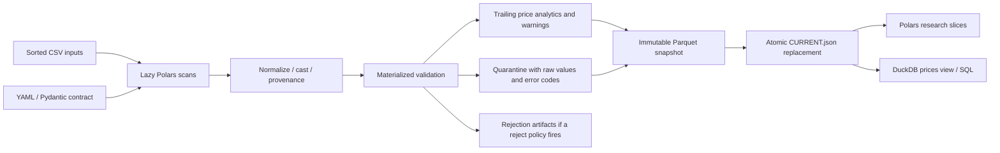

# Architecture and execution boundaries

Research Data Engine is an independent local research utility. The bundled data is **synthetic**; no employer affiliation or endorsement is implied.



`ingest()` in `pipeline.py` composes these steps. There is no scheduler, network data dependency, server, or separate database service. The CLI and public Python API share the same implementations.

## Interactive presentation

`frontend/` is a single-page static walkthrough of the implemented pipeline. `scripts/export_walkthrough.py` runs the real engine against a fresh deterministic synthetic dataset in a temporary directory, then exports raw/canonical record comparisons, quarantine decisions, retained price histories, DuckDB answers, source snippets, and byte-identical measured benchmark reports. The export does not alter a user's existing datasets.

The browser explores those recorded outputs and offers a labelled two-price mathematical example and conceptual publication replay. It does not execute Python ETL, upload CSVs, or run arbitrary SQL. This keeps one authoritative implementation of financial validation and analytics. An optional supplied pytest JUnit report certifies the displayed Python test result; a failing or empty report blocks certification/export. Paths are made portable and raw non-finite values are represented as strings in strict JSON. [Frontend instructions](../frontend/README.md) document build, refresh, downloads, and browser verification.

## Modules

| Module | Responsibility |
|---|---|
| `config` | Strict YAML validation, column mapping, relative paths, policy defaults |
| `ingestion`, `transformations` | Deterministic discovery, `scan_csv`, canonical casts, raw-value and file provenance |
| `validation` | Structural/financial errors, explicit policies, warning flags, accounting |
| `analytics` | Sorted returns and trailing observation-window statistics |
| `storage` | Zstd Parquet, immutable snapshots, manifest resolution, publication |
| `pipeline`, `reporting` | Composition, input fingerprints, run metadata, JSON reports, structured logs |
| `queries` | Restricted local SELECT queries and parameterized date/symbol slices |
| `sample_data` | Deterministic synthetic weekday OHLCV generation |
| `benchmarking`, `_benchmark_worker` | Correctness gates, isolated measurements, JSON/Markdown reports |
| `cli` | Typer commands and readable summaries |

## Lazy and eager execution

CSV scanning, projection, renaming, and casts form a lazy query until `collect(engine="streaming")`. This avoids Python row loops and lets Polars optimize the expression graph. A full ingestion still reads every required field because validation needs it; this is not an out-of-core ETL guarantee.

Global duplicate checks, record-level quarantine, sorted trailing analytics, and reporting operate on a materialized normalized frame. That is a deliberate, simple MVP boundary. Reusing an eager frame is appropriate when the full result is needed repeatedly, when it is small, or when reports need concrete counts. A LazyFrame is appropriate for scans, filtered research slices, and chained transformations where pushdown can eliminate work.

Run `uv run python examples/research_example.py` after the demo to print an **actual optimized query plan**. Its Parquet scan projects only symbol/source/volume plus the predicate column and pushes a date selection into the scan. The resulting operator names depend on the locked Polars version; the example executes `explain(optimized=True)` instead of copying a fictional plan.

## Snapshot layout and publication

```text
data/processed/equity_prices/
├── dataset.json                  # ownership / format marker
├── CURRENT.json                  # selects exactly one immutable version
└── versions/<run-id>/
    ├── prices.parquet            # canonical columns, analytics, provenance, warnings
    ├── quarantine.parquet        # invalid rows, raw mapped values, parse/error codes
    ├── report.json
    └── metadata.json             # format/version and run metadata
```

Publication writes a unique staging directory on the same filesystem, writes and fsyncs artifacts, renames that directory into `versions`, writes/fsyncs a temporary manifest, then calls `os.replace` on `CURRENT.json`. Until that final step, the previous manifest remains active. A pre-publication failure removes only that run's staging artifacts. Readers resolve the manifest once, retaining a consistent snapshot even when a later run is published. Never query `versions/**/*.parquet`: that would mix history and quarantine. Use `QueryEngine`, `load_prices`, or `read_snapshot`.

Identical inputs create a new audited run but the active logical dataset has identical records, never an append. Old snapshots remain available. Automatic retention/garbage collection is **not implemented**; this trades disk space for reproducibility. Each version has one clean file and one quarantine file; no partition explosion.

Atomic visibility relies on same-filesystem `os.replace` semantics. The supported contract is a **single writer on a local filesystem**. Readers do not need a lock. Network filesystems, object stores, concurrent writers, and Windows sharing behavior require further testing or coordination. Files are fsynced, but directory entries are not fsynced: this is not a power-loss durability guarantee. An abrupt process termination can leave an unreferenced staging directory/version; it does not make that version active. Nonempty unmanaged output directories are refused.

Rejected runs write `data/processed/rejected/<run-id>/{report.json,quarantine.parquet}` without changing the active snapshot. A reject policy rejects the whole run even when other rows pass validation. Structural failures before row validation raise an actionable exception without a row-level report.

## Reproducibility

Reports include UTC start time, resolved configuration, input SHA-256 fingerprints, Python/package versions, counts, duration, and source labels. The pipeline checks file identity, size, and modification time around scanning to catch inputs changed during the run. Use immutable inputs; these checks are not a filesystem transaction or protection from adversarial mutation. Run IDs and timestamps vary; seeded CSV contents, output ordering, and financial values are deterministic under the locked dependencies.

`processing_duration_seconds` covers discovery, hashing, scanning, validation, and analytics; it excludes Parquet publication. This boundary is recorded in the report. Revalidation records a new timestamp and identifies the snapshot version, without changing its original artifacts.
